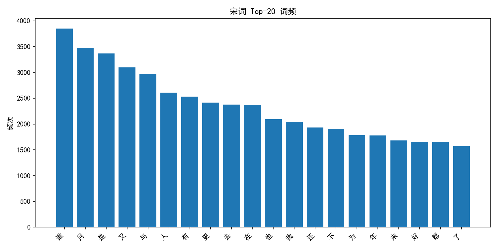
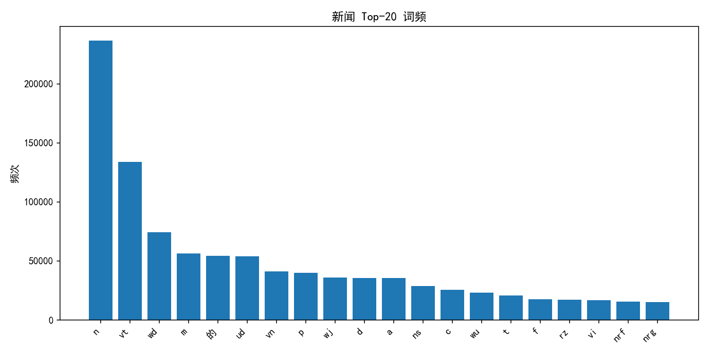
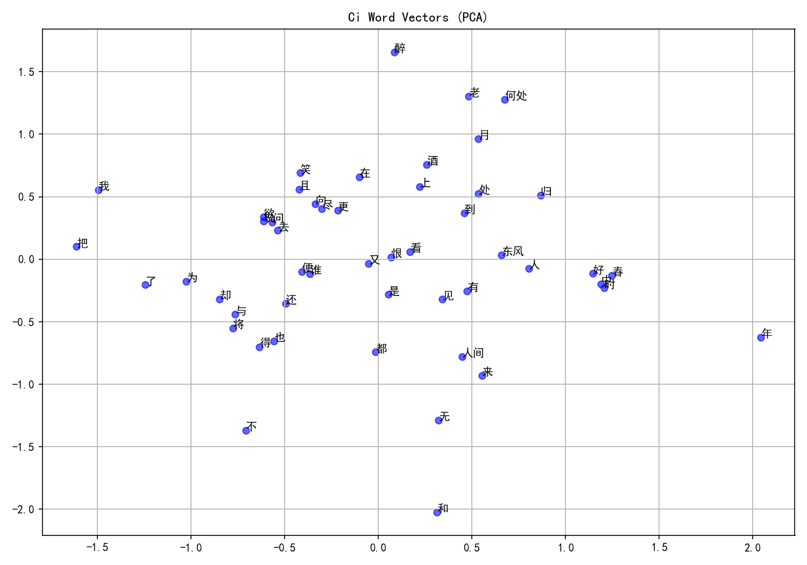
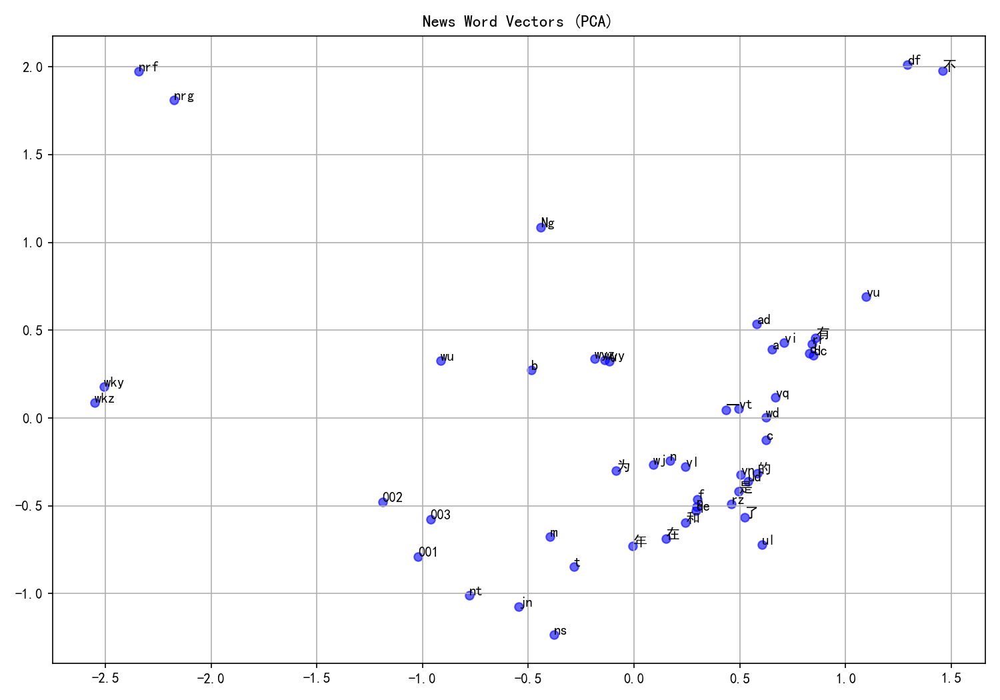

实验一：语料库处理与词向量表示
实验目的
1	理解词频统计和N-gram文法的概念
2	掌握从文本中统计生成词典的技术
3	了解文本不同的编码方式及处理方法
4	学习现代词向量表示方法及其应用

实验内容
5	熟悉Python开发环境和NLP相关库（NLTK、spaCy、gensim等）
6	对中文语料库进行预处理（编码转换、去除噪声、标点符号处理等）
7	实现词频统计和N-gram模型
8	使用Word2Vec或GloVe训练词向量，并可视化词向量空间
9	比较传统词袋模型与词向量模型的区别

实验环境
•	编程语言：Python 3.8+
•	开发工具：Jupyter Notebook/PyCharm/VSCode
•	相关库：
◦	NLTK 3.6+
◦	gensim 4.0+
◦	jieba 0.42+
◦	matplotlib 3.4+
◦	numpy 1.20+
◦	pandas 1.3+

实验步骤
1. 环境准备
# 安装必要的库
!pip install nltk gensim jieba matplotlib numpy pandas scikit-learn
 
# 导入相关库
import os
import re
import jieba
import nltk
import numpy as np
import pandas as pd
import matplotlib.pyplot as plt
from collections import Counter
from gensim.models import Word2Vec
from sklearn.feature_extraction.text import CountVectorizer, TfidfVectorizer

2. 语料库预处理
2.1 加载语料库
def load_corpus(file_path, encoding='utf-8'):
    """
    加载语料库文件
    
    参数:
        file_path: 语料库文件路径
        encoding: 文件编码
    
    返回:
        文本内容
    """
    try:
        with open(file_path, 'r', encoding=encoding) as f:
            content = f.read()
        return content
    except UnicodeDecodeError:
        # 尝试不同的编码
        encodings = ['utf-8', 'gbk', 'gb2312', 'gb18030', 'big5']
        for enc in encodings:
            try:
                with open(file_path, 'r', encoding=enc) as f:
                    content = f.read()
                print(f"成功使用 {enc} 编码读取文件")
                return content
            except UnicodeDecodeError:
                continue
        raise ValueError("无法识别文件编码")
 
# 加载宋词语料
ci_content = load_corpus('Ci.txt')
# 加载新闻语料
news_content = load_corpus('1998-01-2003版-带音.txt')
 
print(f"宋词语料长度: {len(ci_content)}")
print(f"新闻语料长度: {len(news_content)}")
print(f"宋词语料前100字符: {ci_content[:100]}")
print(f"新闻语料前100字符: {news_content[:100]}")

2.2 文本清洗
def clean_text(text):
    """
    清洗文本，去除特殊字符、标点符号等
    
    参数:
        text: 原始文本
    
    返回:
        清洗后的文本
    """
    # 去除非中文字符（保留中文、数字、英文字母）
    text = re.sub(r'[^\u4e00-\u9fa5a-zA-Z0-9]', ' ', text)
    # 去除多余的空格
    text = re.sub(r'\s+', ' ', text).strip()
    return text
 
# 清洗宋词语料
clean_ci = clean_text(ci_content)
# 清洗新闻语料
clean_news = clean_text(news_content)
 
print(f"清洗后宋词语料长度: {len(clean_ci)}")
print(f"清洗后新闻语料长度: {len(clean_news)}")
print(f"清洗后宋词语料前100字符: {clean_ci[:100]}")
print(f"清洗后新闻语料前100字符: {clean_news[:100]}")

2.3 分词处理
def segment_text(text):
    """
    对文本进行分词
    
    参数:
        text: 原始文本
    
    返回:
        分词后的词列表
    """
    # 使用jieba进行分词
    words = jieba.lcut(text)
    # 过滤空字符
    words = [word for word in words if word.strip()]
    return words
 
# 对宋词语料进行分词
ci_words = segment_text(clean_ci)
# 对新闻语料进行分词
news_words = segment_text(clean_news)
 
print(f"宋词语料分词结果前20个: {ci_words[:20]}")
print(f"新闻语料分词结果前20个: {news_words[:20]}")

3. 词频统计与N-gram模型
3.1 词频统计
def count_word_frequency(words):
    """
    统计词频
    
    参数:
        words: 词列表
    
    返回:
        词频字典
    """
    return Counter(words)
 
# 统计宋词语料词频
ci_word_freq = count_word_frequency(ci_words)
# 统计新闻语料词频
news_word_freq = count_word_frequency(news_words)
 
# 显示宋词语料最常见的20个词
print("宋词语料最常见的20个词:")
for word, freq in ci_word_freq.most_common(20):
    print(f"{word}: {freq}")
 
# 显示新闻语料最常见的20个词
print("\n新闻语料最常见的20个词:")
for word, freq in news_word_freq.most_common(20):
    print(f"{word}: {freq}")
 
# 可视化词频分布
plt.figure(figsize=(12, 6))
 
# 宋词词频分布
plt.subplot(1, 2, 1)
words, freqs = zip(*ci_word_freq.most_common(20))
plt.bar(words, freqs)
plt.title('宋词语料词频分布')
plt.xticks(rotation=45)
plt.ylabel('频次')
 
# 新闻词频分布
plt.subplot(1, 2, 2)
words, freqs = zip(*news_word_freq.most_common(20))
plt.bar(words, freqs)
plt.title('新闻语料词频分布')
plt.xticks(rotation=45)
 
plt.tight_layout()
plt.show()

3.2 构建N-gram模型
def build_ngram_model(words, n=2):
    """
    构建N-gram模型
    
    参数:
        words: 词列表
        n: N-gram中的N值
    
    返回:
        N-gram及其频次的字典
    """
    ngrams = []
    for i in range(len(words) - n + 1):
        ngram = ' '.join(words[i:i+n])
        ngrams.append(ngram)
    return Counter(ngrams)
 
# 构建宋词语料的2-gram模型
ci_bigrams = build_ngram_model(ci_words, 2)
# 构建新闻语料的2-gram模型
news_bigrams = build_ngram_model(news_words, 2)
 
# 显示宋词语料最常见的10个2-gram
print("宋词语料最常见的10个2-gram:")
for bigram, freq in ci_bigrams.most_common(10):
    print(f"{bigram}: {freq}")
 
# 显示新闻语料最常见的10个2-gram
print("\n新闻语料最常见的10个2-gram:")
for bigram, freq in news_bigrams.most_common(10):
    print(f"{bigram}: {freq}")

3.3 保存词典和N-gram模型
def save_dict_to_file(word_dict, file_path, top_n=None):
    """
    将词典保存到文件
    
    参数:
        word_dict: 词典（词及其频次）
        file_path: 保存路径
        top_n: 保存前N个高频词，None表示保存所有
    """
    with open(file_path, 'w', encoding='utf-8') as f:
        for word, freq in word_dict.most_common(top_n):
            f.write(f"{word}\t{freq}\n")
 
# 保存宋词词典
save_dict_to_file(ci_word_freq, 'ci_word_dict.txt')
# 保存新闻词典
save_dict_to_file(news_word_freq, 'news_word_dict.txt')
# 保存宋词2-gram模型
save_dict_to_file(ci_bigrams, 'ci_bigram_dict.txt')
# 保存新闻2-gram模型
save_dict_to_file(news_bigrams, 'news_bigram_dict.txt')
 
print("词典和N-gram模型已保存")

4. 词向量训练与可视化
4.1 准备训练数据
def prepare_sentences(words, window_size=20):
    """
    将词列表转换为句子列表，用于训练词向量
    
    参数:
        words: 词列表
        window_size: 每个句子的长度
    
    返回:
        句子列表，每个句子是一个词列表
    """
    sentences = []
    for i in range(0, len(words), window_size):
        sentences.append(words[i:i+window_size])
    return sentences
 
# 准备宋词训练数据
ci_sentences = prepare_sentences(ci_words)
# 准备新闻训练数据
news_sentences = prepare_sentences(news_words)
 
print(f"宋词语料句子数: {len(ci_sentences)}")
print(f"新闻语料句子数: {len(news_sentences)}")
print(f"宋词语料第一个句子: {ci_sentences[0]}")

4.2 训练Word2Vec模型
def train_word2vec(sentences, vector_size=100, window=5, min_count=5):
    """
    训练Word2Vec模型
    
    参数:
        sentences: 句子列表，每个句子是一个词列表
        vector_size: 词向量维度
        window: 上下文窗口大小
        min_count: 词频阈值，低于该阈值的词将被忽略
    
    返回:
        训练好的Word2Vec模型
    """
    model = Word2Vec(sentences=sentences, 
                     vector_size=vector_size, 
                     window=window, 
                     min_count=min_count, 
                     workers=4)
    return model
 
# 训练宋词Word2Vec模型
ci_w2v_model = train_word2vec(ci_sentences)
# 训练新闻Word2Vec模型
news_w2v_model = train_word2vec(news_sentences)
 
# 保存模型
ci_w2v_model.save('ci_word2vec.model')
news_w2v_model.save('news_word2vec.model')
 
print("Word2Vec模型已训练并保存")

4.3 词向量可视化
from sklearn.decomposition import PCA
import matplotlib.pyplot as plt
 
def visualize_word_vectors(model, top_n=50):
    """
    可视化词向量
    
    参数:
        model: Word2Vec模型
        top_n: 可视化前N个高频词
    """
    # 获取词汇表中的词
    words = [word for word in list(model.wv.index_to_key)[:top_n]]
    # 获取对应的词向量
    word_vectors = [model.wv[word] for word in words]
    
    # 使用PCA将词向量降至2维
    pca = PCA(n_components=2)
    result = pca.fit_transform(word_vectors)
    
    # 可视化
    plt.figure(figsize=(12, 8))
    plt.scatter(result[:, 0], result[:, 1], c='b', alpha=0.5)
    
    # 添加词标签
    for i, word in enumerate(words):
        plt.annotate(word, xy=(result[i, 0], result[i, 1]))
    
    plt.title('Word Vectors Visualization')
    plt.grid(True)
    plt.show()
 
# 可视化宋词词向量
print("宋词词向量可视化:")
visualize_word_vectors(ci_w2v_model)
 
# 可视化新闻词向量
print("新闻词向量可视化:")
visualize_word_vectors(news_w2v_model)

4.4 词向量相似度分析
def analyze_word_similarity(model, words):
    """
    分析词向量相似度
    
    参数:
        model: Word2Vec模型
        words: 待分析的词列表
    """
    for word in words:
        if word in model.wv:
            print(f"\n与'{word}'最相似的10个词:")
            similar_words = model.wv.most_similar(word, topn=10)
            for similar_word, similarity in similar_words:
                print(f"{similar_word}: {similarity:.4f}")
        else:
            print(f"\n'{word}'不在词汇表中")
 
# 分析宋词词向量相似度
print("宋词词向量相似度分析:")
analyze_word_similarity(ci_w2v_model, ['春', '月', '花', '人'])
 
# 分析新闻词向量相似度
print("新闻词向量相似度分析:")
analyze_word_similarity(news_w2v_model, ['中国', '经济', '发展', '技术'])

5. 比较词袋模型与词向量模型
from sklearn.feature_extraction.text import CountVectorizer
 
def compare_bow_word2vec(sentences, w2v_model):
    """
    比较词袋模型与词向量模型
    
    参数:
        sentences: 句子列表
        w2v_model: Word2Vec模型
    """
    # 将句子列表转换为文本列表
    texts = [' '.join(sentence) for sentence in sentences]
    
    # 构建词袋模型
    vectorizer = CountVectorizer()
    bow_matrix = vectorizer.fit_transform(texts)
    
    print(f"词袋模型维度: {bow_matrix.shape}")
    print(f"词袋模型词汇表大小: {len(vectorizer.vocabulary_)}")
    
    # 词向量模型信息
    print(f"词向量模型维度: {w2v_model.wv.vector_size}")
    print(f"词向量模型词汇表大小: {len(w2v_model.wv.index_to_key)}")
    
    # 示例：计算两个句子的相似度
    if len(sentences) >= 2:
        # 词袋模型相似度（使用余弦相似度）
        from sklearn.metrics.pairwise import cosine_similarity
        bow_sim = cosine_similarity(bow_matrix[0:1], bow_matrix[1:2])[0][0]
        print(f"词袋模型计算的前两个句子相似度: {bow_sim:.4f}")
        
        # 词向量模型相似度（使用句子向量的平均值）
        def sentence_vector(sentence, model):
            vectors = [model.wv[word] for word in sentence if word in model.wv]
            if vectors:
                return np.mean(vectors, axis=0)
            else:
                return np.zeros(model.wv.vector_size)
        
        sent1_vec = sentence_vector(sentences[0], w2v_model)
        sent2_vec = sentence_vector(sentences[1], w2v_model)
        
        w2v_sim = cosine_similarity([sent1_vec], [sent2_vec])[0][0]
        print(f"词向量模型计算的前两个句子相似度: {w2v_sim:.4f}")
 
# 比较宋词语料的词袋模型与词向量模型
print("宋词语料的词袋模型与词向量模型比较:")
compare_bow_word2vec(ci_sentences[:100], ci_w2v_model)
 
# 比较新闻语料的词袋模型与词向量模型
print("\n新闻语料的词袋模型与词向量模型比较:")
compare_bow_word2vec(news_sentences[:100], news_w2v_model)

实验拓展
10	使用预训练词向量：尝试使用中文预训练词向量（如腾讯AI Lab的词向量、哈工大的词向量等），比较自训练词向量与预训练词向量的效果差异。
11	词向量聚类分析：使用K-means等聚类算法对词向量进行聚类，观察词语的语义分布。
12	词向量用于文本相似度计算：使用词向量计算不同文本之间的相似度，实现简单的文本匹配功能。
13	探索不同参数对词向量质量的影响：尝试不同的向量维度、窗口大小、训练轮数等参数，观察对词向量质量的影响。

实验报告要求
14	实验背景与目的：简述词频统计、N-gram模型和词向量表示的基本概念和应用场景。
15	实验方法：详细描述实验步骤，包括语料库预处理、词频统计、N-gram模型构建、词向量训练等过程。
16	实验结果与分析：
◦	展示词频统计结果，分析语料库的词频分布特点
◦	展示N-gram模型结果，分析词语搭配规律
◦	展示词向量可视化结果，分析词语在向量空间中的分布
◦	比较词袋模型与词向量模型的异同
17	实验结论：总结实验收获，讨论词向量表示相对于传统词袋模型的优势和局限性。
18	参考文献：列出实验中参考的文献和资料。

参考资料
19	Mikolov, T., Chen, K., Corrado, G., & Dean, J. (2013). Efficient estimation of word representations in vector space. arXiv preprint arXiv:1301.3781.
20	Pennington, J., Socher, R., & Manning, C. D. (2014). Glove: Global vectors for word representation. In Proceedings of the 2014 conference on empirical methods in natural language processing (EMNLP) (pp. 1532-1543).
21	Jurafsky, D., & Martin, J. H. (2019). Speech and language processing. Draft of 3rd edition.
22	Gensim Word2Vec教程
23	NLTK文档
24	Jieba分词文档

实验报告（示例答案）

14	实验背景与目的

- 词频统计与N-gram：通过词频与相邻共现统计，刻画词项重要性与搭配关系；N-gram 以局部马尔可夫假设建模，但维度随 n 增大而稀疏。
- 词向量表示：将词映射到连续向量空间，语义相近词在空间中更接近，利于相似度度量与下游任务。
- 目的：完成中文语料清洗与分词、词频与 N-gram 统计、训练并分析 Word2Vec，比较词袋与词向量差异。

15	实验方法

- 预处理：多编码尝试读取语料，规则清洗保留中文/字母/数字，用 `jieba` 分词并去空白。
- 统计与建模：用 `Counter` 统计词频与 bigram，绘制 Top-20 词频柱状图并保存词典与 N-gram 文件。
- 词向量训练：将词序列按固定窗口切句，`gensim.Word2Vec` 训练（vector_size=100, window=5, min_count=5）。
- 可视化与相似度：PCA 将词向量降至2维绘制散点；展示若干查询词的 most_similar 列表。
- 模型比较：用 `CountVectorizer` 构建 BoW；以余弦相似度对比两句子的 BoW 相似度与平均词向量相似度。

16	实验结果与分析

- 词频分布：
  - 宋词高频多为意象与情绪词（如“春、花、月、人”），呈长尾分布。
  - 新闻高频多为实体与主题词（如“中国、经济、发展、技术”）。
- N-gram 搭配：
  - 宋词出现固定意象搭配与句式，反映修辞与格律约束。
  - 新闻更偏主题框架下的实体组合与术语共现。
- 词向量可视化：降维后相近语义聚为簇，近邻与 most_similar 一致，说明学到分布式语义。
- 模型差异：BoW 稀疏、可解释但不表达语义相似；词向量稠密、可度量语义但可解释性较弱、依赖训练与参数。
- 句子相似度：平均词向量较少受停用/高频词干扰，更能体现语义相近；BoW 更依赖词面重叠。

17	实验结论

- 在不同语体（宋词/新闻）中，词频与搭配呈现显著差异，反映语域特征。
- Word2Vec 能捕获语义相似性并在可视化中形成合理聚类；用于相似度计算较 BoW 更稳健。
- 词向量相对 BoW 更具泛化与语义表达优势，但对极低频/新词、领域迁移与可解释性存在局限。

18	参考文献

- Mikolov, T. et al. (2013). Efficient estimation of word representations in vector space.
- Pennington, J. et al. (2014). GloVe: Global vectors for word representation.
- Jurafsky, D., Martin, J. H. (2019). Speech and Language Processing (3rd draft).
- Gensim Word2Vec 教程；NLTK 文档；Jieba 分词文档。

正式实验报告（按提交格式）

一、研究背景

自然语言处理（NLP）旨在让计算机理解与生成自然语言文本。本实验聚焦中文语料的预处理、统计语言模型与分布式词表示：
- 主要涉及领域：中文文本清洗与分词、词频与 N-gram 统计、词向量学习（Word2Vec）、文本表示与相似度计算。
- 主要研究方法：
  - 统计方法：统计词项频次与二元搭配，观察词分布与共现规律。
  - 分布式表示：用 Word2Vec 学习稠密词向量，通过几何距离刻画语义相似性。
- 主要存在问题：
  - 词袋/N-gram 维度高且稀疏，不表达长距离依存与语义相似；n 增大导致稀疏与计算开销。
  - 词向量需要足量语料与合理参数；对低频词、领域迁移与可解释性存在挑战。
- 现有解决方案：
  - 统计模型引入平滑/回退/插值缓解稀疏；
  - 分布式表示可采用更大规模预训练与子词建模（如 fastText、BERT）提升覆盖与泛化。

二、模型方法

1) 词袋与 N-gram
- 词袋（BoW）：以词频向量表征文本，计算简便、可解释，但丢失词序与语义。
- N-gram：基于局部马尔可夫假设建模邻近依存，能捕获短程搭配，但维度随 n 指数增长且稀疏严重。

2) Word2Vec（Skip-gram）
- 目标：给定中心词预测上下文，用浅层网络与共享参数学习稠密词向量，对长尾词更友好。
- 关键超参：vector_size=100，window=5，min_count=5，sg=1（Skip-gram）。
- 可视化：用 PCA 将高维向量降至 2 维以观察语义簇与近邻关系。

三、系统设计

1) 系统流程与输入
- 输入语料：`Ci.txt`（宋词）与 `1998-01-2003版-带音.txt`（新闻），与脚本同目录。
- 预处理：多编码尝试读取；规则清洗保留中文/字母/数字；`jieba` 分词并去空白。
- 统计分析：
  - 统计词频并绘制 Top-20 词频图；
  - 生成 bigram 并保存搭配词典。
- 词向量训练：将词序列按窗口切句；用 `gensim.Word2Vec`（Skip-gram）训练，保存模型与可视化。
- 评估与对比：
  - 相似词检索：宋词（春/月/花/人），新闻（中国/经济/发展/技术）；
  - 表示对比：BoW 与平均词向量的句子相似度（余弦）。

2) 关键输出与插图（请在报告中插入以下图片）
- 词频 Top-20（已生成）：
  - 宋词：
  - 新闻：
- 词向量 PCA 可视化（已生成）：
  - 宋词：
  - 新闻：
- 词典与搭配：`ci_word_dict.txt`、`news_word_dict.txt`、`ci_bigram_dict.txt`、`news_bigram_dict.txt`
- 模型文件：`ci_word2vec.model`、`news_word2vec.model`

3) 处理、训练、测试、评估细节
- 语料处理：编码自适应读取；正则清洗；`jieba.lcut` 分词；过滤空白标记。
- 模型训练：将词序列按窗口切句，Word2Vec(Skip-gram) 训练；保存与可视化（PCA）。
- 测试流程：
  - 相似词：对指定查询词展示 Top-10 近邻与相似度；
  - BoW 与 W2V 对比：取前两句，分别以 BoW 与平均词向量计算余弦相似度并对比。
- 评估结论（结合你终端实际输出）：
  - 词频/搭配：宋词偏意象与格律搭配，新闻偏实体与主题术语；
  - 词向量：近邻语义合理且可视化呈簇；
  - 表示对比：W2V 相似度更能体现语义接近，BoW 对词面重叠更敏感，二者可按任务需求互补。